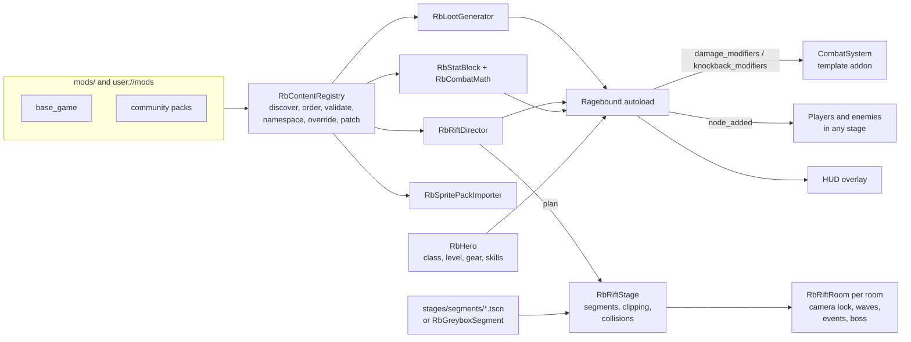

# RAGEBOUND

> A side-scrolling combat ARPG that happens to play like *Streets of Rage*.

Every run takes you through procedurally assembled streets, criminal strongholds, factories and
underground arenas. Each character has a fighting discipline, customizable combos, equipment,
skills and finishers. Randomized loot doesn't just raise numbers: it changes how the
beat-'em-up combat plays.

This repository is the Godot 4 foundation for it, built on the
[Downtown Beatdown](https://quiver.dev) beat-'em-up template.

---

## 1. Design pillars

| Pillar | What it brings |
| --- | --- |
| **Streets of Rage**: physical combat | Punches, kicks, grapples, throws, juggles, wall bounces, hazards, positioning. |
| **Mortal Kombat**: fighting depth | Special inputs, counters, launchers, breakers, fatalities, cinematic boss attacks. |
| **Diablo**: progression | Classes, rarity tiers, affixes, build-defining uniques, skill trees, elements, set bonuses. |
| **Roguelike**: replayable runs | Procedural routes, randomized encounters, elite modifiers, bosses, mutators, rising rift levels. |

The rule that drives most technical decisions: **don't make a Streets of Rage clone with RPG
features bolted on.** Combat stats, loot and the run structure live in one data-driven layer
that every hit passes through.

### Classes

Classes are combat archetypes, each with two specializations. All ten ship as data in
`mods/base_game/classes/`. The vertical slice focuses on Brawler and Grappler, which have full
skill trees.

| Class | Identity | Specializations |
| --- | --- | --- |
| Brawler | Traditional street fighter | Combo / Counter |
| Grappler | Throws, slams, holds | Wrestling / Brutality |
| Martial Artist | Fast strikes, launchers | Dragon / Shadow |
| Enforcer | Heavy weapons, armor | Juggernaut / Executioner |
| Assassin | Mobility, critical damage | Bleed / Poison |
| Street Samurai | Bladed combat | Iaijutsu / Blood |
| Gunslinger | Ammunition, firearms | Gun-Fu / Demolition |
| Occultist | Supernatural strikes | Hex / Soul |
| Cyborg | Technological enhancements | Cybernetics / Overload |
| Monk | Ki, deflections, pressure | Discipline / Tempest |

Each class has three layers: its fundamental move set, an unlockable skill tree, and equipment
that changes how moves work. *The Pile Drivers* (legendary gloves) push every hit one knockback
tier harder, so a jab launches like a throw. *Widowmaker* executes wounded non-boss enemies.

### Rifts

Rifts are **assembled from hand-made stage segments**, never generated pixel by pixel, so the
Genesis-era art direction survives. A seeded director:

1. picks a rift template (a list of room roles such as `entry → combat ×1-3 → elite → event → boss`),
2. chains stage segments whose exit and entry **connectors** match (`street`, `alley_mouth`, `door`, `loading_dock` ...),
3. places an encounter in each room and spends a **threat budget** on enemies that fit the theme,
4. promotes some enemies to **elites** with Diablo-style modifiers (Armored, Berserker, Vampiric ...),
5. places a **boss** only in a segment that satisfies its arena requirements (size and features like `walls` or `hooks`),
6. rolls **mutators** that change both sides (Blood Moon, Glass Cannon, Elite Surge ...).

Because bosses declare their requirements, a boss is a reusable content package rather than a
hard-coded stage script. Add a boss with a compatible arena and the director starts using it.

---

## 2. What exists today

| Area | Status |
| --- | --- |
| Beat-'em-up combat, animation state machines, AI, stage blocking | From the template |
| Mod system: manifests, dependencies, namespaced ids, overrides, patches | Done (`ragebound/core`) |
| Schema validation with readable errors, reference checks, semantic checks | Done |
| Stat system shared by players, monsters, gear, skills, elites and mutators | Done (`ragebound/stats`) |
| Loot: rarities, affix tiers by item level, exclusive groups, uniques, sets, loot tables, magic find | Done (`ragebound/loot`) |
| Hero progression: XP curve, levels, skill trees with tiers and prerequisites, save/load | Done (`ragebound/run`) |
| Rift director: segment chaining, encounters, budgets, elites, minibosses, boss arena legality, mutators | Done (`ragebound/rift`) |
| Live gameplay hooks: stat-driven damage, crits, armor, elements, life on hit/kill, thorns, execute, knockback tiers, monster scaling, boss phases, XP and loot on kill | Done (`ragebound/run/ragebound.gd`) |
| HUD: loot/XP feed, rift status, character sheet (Tab / I / gamepad Back), damage numbers | Done (`ragebound/ui`) |
| Sprite pack standard, importer, role qualification, previewer | Done (`ragebound/sprites`, `ragebound/tools`) |
| CLI: validate, preview rifts, roll loot, check sprite packs | Done (`ragebound/tools/ragebound_cli.gd`) |
| Headless tests and CI | Done (`ragebound/tests`, `.github/workflows/ragebound.yml`) |
| Stage assembler: builds each rift as a real level from segment scenes, with camera-locked rooms, waves, events, boss arenas and victory | Done (`ragebound/stages`) |
| Seven street segments cut from `stage_01` by the stage slicer, plus greybox blockouts for alley, club and factory | Done (`stages/segments`, `ragebound/tools/stage_slicer.tscn`) |
| Shop with real items, more event types, loot pickups in the world | Next (the shop is a street doc that heals for gold) |
| Skill tree and inventory screens (skills auto-allocate, drops auto-equip for now) | Next |
| New fighters and enemy bodies from sprite packs | Next: the content currently reuses Chad, Sargent and Tax Man bodies with tints |
| Special inputs, grabs/throws for Grappler, fatality finishers | Next |
| Local co-op | Later |

### How a rift becomes a level

Pressing **Play** loads `ragebound/stages/rift_stage.tscn`. It asks the director for a plan,
then for each room:

1. Instances the room's **stage segment** scene, or builds a **greybox** blockout when the
   segment has no art yet, and places it after the previous one.
2. Clips the segment's Background and Foreground to its own width, so overhanging art never
   bleeds into the neighbour. Props (gates, thrones) join the level's y-sorted layer so
   characters walk behind and in front of them.
3. Uses the segment's exact collision polygons, or builds a flat walkable band from its floor
   values.
4. Adds an **RbRiftRoom**. When the player crosses its trigger, the camera locks to the room and
   the planned spawns walk in from off screen in waves of up to four, leaders first. Clearing
   the room unlocks the camera forward and shows **GO! >>>**.

Room roles change what happens: ambush and elite rooms announce themselves, minibosses and
bosses get an intro line, the **shop** is a street doc that heals you for gold, and **rescue**
and **challenge** events pay out an extra loot roll. In the boss room, a boss whose body
supports it (the Tax Man) waits seated on the throne, gets up when you enter, and engages once
his guards are down. Beating the boss opens the victory screen; restarting from it (or after a
defeat) starts a new rift. Restarting from the pause menu replays the same rift.

The original `stages/stage_01/stage_01.tscn` is still in the project as the source art for the
slicer and can be run on its own (F6). There, the plan's spawns are matched to the bodies the
hand-made stage spawns.

---

## 3. Architecture



Design rules:

- **Everything is content.** The base game is a mod (`mods/base_game`) loaded through the same
  code path as community packs. If the base game can do something, a mod can too.
- **Pure logic, thin glue.** Registry, loot, stats, director, hero and importer are
  `RefCounted` classes with no node dependencies, so they're unit tested headless. The scene
  tree is touched only by the `Ragebound` autoload and the stage assembler in
  `ragebound/stages`.
- **Deterministic.** Every generator takes an `RbRng`. `fork(label)` gives each system its own
  stream, so adding a roll to loot never reshuffles rift layouts. Same seed, same run.
- **Minimal template changes.** The addon gained two hook lists on `CombatSystem`
  (`damage_modifiers`, `knockback_modifiers`), a `damage_applied` signal, and an optional
  `attacker` argument. Everything else is layered on top.

---

## 4. Running it

| What | How |
| --- | --- |
| Play | Open the project in Godot 4 and run it, then press Play. Each run is a new rift. Press **Tab**, **I** or gamepad **Back** for the character sheet. |
| Tests | `godot --headless -s res://ragebound/tests/run_tests.gd` |
| Play-through test | `godot --headless --fixed-fps 60 res://ragebound/tests/rift_stage_test.tscn` builds four seeded rifts, checks the player can walk from start to boss, clears every room and beats the boss |
| Re-cut street segments | Edit the slice list in `ragebound/tools/stage_slicer.gd`, then run `res://ragebound/tools/stage_slicer.tscn` |
| Validate mods | `godot --headless -s res://ragebound/tools/ragebound_cli.gd -- validate` |
| Preview a rift | `... ragebound_cli.gd -- rift --seed 7 --rift industrial_rift --level 4` (add `--json` for the raw plan) |
| Roll loot | `... ragebound_cli.gd -- loot --ilvl 14 --count 10 --mf 200` or `--table boss` |
| Check a sprite pack | `... ragebound_cli.gd -- sprite my_mod:my_fighter` |
| Browse sprite packs | Run `res://ragebound/tools/sprite_pack_previewer.tscn` |

On a fresh clone, open the project in the editor once (or run
`godot --headless --editor --quit-after 300` and stop it after a few seconds) so Godot builds its
class cache before using the command-line tools.

Example rift preview:

```
Industrial Rift  (seed 7, rift level 4, monster level 6)
  mutators: base_game:blood_moon, base_game:iron_skin
  1. entry   storefront_corner      quiet_start          runner, bruiser
  2. combat  torii_gate             street_brawl         runner, ELITE[juggernaut] heavy, street_thug, heavy, runner
  ...
  5. elite   java_tiger_strip       miniboss_showdown    MINIBOSS bouncer_king, street_thug, street_thug
  6. event   foster_mart            challenge_arena      [challenge] ELITE[armored+berserker] street_thug, ...
  7. combat  loading_dock           heavy_hitters        line_worker, ...
  8. boss    slaughterhouse_floor   boss_fight           BOSS iron_butcher, line_worker, line_worker, line_worker
```

---

## 5. Modding guide

### Folder layout

```
mods/                      shipped with the game (res://mods)
  base_game/
    manifest.json
    classes/ characters/ skills/
    enemies/ bosses/ elite_modifiers/
    items/ affixes/ rarities/ uniques/ sets/ loot_tables/
    stages/ encounters/ rifts/ mutators/
    sprite_packs/
user://mods/               player-installed mods, same layout
```

Each `.json` file in a content folder holds one entry or a list of entries. A complete example
mod lives in [`examples/mods/example_community_pack`](../examples/mods/example_community_pack):
copy it into `user://mods/` to try it.

### Manifest

```json
{
	"id": "neon_district",
	"name": "Neon District",
	"version": "1.0.0",
	"ragebound_api": 1,
	"dependencies": ["base_game"],
	"load_priority": 0,
	"authors": ["you"]
}
```

Mods load after their dependencies; ties break by `load_priority`, then by id. Missing
dependencies, cycles and newer API versions are reported and that mod is skipped. The rest
still load.

### Ids, overrides and patches

- Ids are lowercase snake_case. They're stored namespaced: `iron_butcher` in `base_game` becomes
  `base_game:iron_butcher`.
- References can use the short id. Resolution order is your mod, then your dependencies, then
  any unique match. Use the full id when it could be ambiguous.
- **Override:** use another mod's full id to replace that entry entirely:
  `{"id": "base_game:glass_cannon", "name": "Glass Cannon+", ...}`
- **Patch:** add `"patch": true` to deep-merge only the fields you list:
  `{"id": "base_game:street_thug", "patch": true, "stats": {"life_pct": 15}}`
- Relative file paths (`scene`, `sheet`) resolve inside your mod folder. `res://` paths point
  into the game.

### Content types

| Folder | Type | Key fields |
| --- | --- | --- |
| `classes` | class | `name`, `specializations[]`, `base_stats`, `per_level`, `starting_items[]` |
| `characters` | character | `name`, `default_class`, `scene`, `sprite_pack` |
| `skills` | skill | `class`, `specialization`, `tier` (unlocks every 3 levels), `max_rank`, `stats_per_rank`, `requires[]` |
| `enemies` | enemy | `scene`, `archetype` (grunt, brute, runner, ranged, grappler, support), `threat`, `xp`, `themes[]`, `stats`, `tint`, `loot_table`, `min_depth`, `can_be_elite` |
| `bosses` | boss | `tier` (miniboss or boss), `scene`, `themes[]`, `arena {min_width, min_depth, features[]}`, `phases[] {below_health, unlock[], stats}`, `moves[]`, `xp`, `loot_table` |
| `elite_modifiers` | elite_modifier | `name`, `stats`, `tint`, `incompatible[]`, `min_depth` |
| `items` | item_base | `slot` (weapon, head, chest, gloves, belt, boots, ring, amulet), `item_type`, `level_req`, `implicit` |
| `affixes` | affix | `kind` (prefix or suffix), `name`, `slots[]`, `group` (exclusive), `tiers[] {min_ilvl, stats}` |
| `rarities` | rarity | `order`, `color`, `weight`, `min_ilvl`, `generates` (affixes, unique or set), `affixes {min,max}`, `max_prefixes`, `max_suffixes`, `magic_find_scaling` |
| `uniques` | unique | `base`, `rarity` (default legendary), `set`, `min_ilvl`, `stats`, `flavor` |
| `sets` | set | `bonuses[] {pieces, stats}` |
| `loot_tables` | loot_table | `rolls {min,max}`, `no_drop_weight`, `rarity_bonus`, `entries[] {kind: item, gold or table, weight, ...}` |
| `stages` | stage_segment | `theme`, `scene`, `width`, `depth` (walkable floor height in px), `roles[]`, `entry[]`, `exit[]`, `features[]`, `min_depth` |
| `encounters` | encounter | `role`, `themes[]`, `archetypes[]`, `budget_mult`, `max_enemies`, `event`, `miniboss_chance` |
| `rifts` | rift | `themes[]`, `steps[] {role, repeat {min,max}, chance}`, `base_budget`, `budget_per_room`, `elite_modifiers {min,max}`, `mutators {min,max}`, `monster_level_offset` |
| `mutators` | mutator | `enemy_stats`, `player_stats`, `elite_chance_bonus`, `loot_bonus_pct`, `xp_bonus_pct` |
| `sprite_packs` | sprite_pack | `sheet`, `cell {width,height}`, `origin {x,y}`, `animations {name: {row, column, frames, fps, loop, hit_frames[]}}` |

The full schema, including bounds and enums, is in
[`ragebound/core/rb_content_schema.gd`](../ragebound/core/rb_content_schema.gd). Unknown fields
are errors, so typos never fail silently. `min_depth` always means the minimum **rift level**.

### Stats

Every `stats` object uses the same ids, whether it belongs to a class, item, skill, elite or
mutator. Percentages are whole numbers (`25` means 25%). Item and affix stats can be
`[min, max]` ranges and roll when the item drops.

`life`, `life_pct`, `armor`, `resist_all`, `damage_reduction_pct`, `thorns`, `damage_flat`,
`damage_pct`, `fire_damage`, `shock_damage`, `poison_damage`, `crit_chance`, `crit_damage_pct`,
`damage_vs_elites_pct`, `damage_vs_bosses_pct`, `knockback_tier`, `execute_threshold_pct`,
`life_on_hit`, `life_on_kill`, `move_speed_pct`, `xp_gain_pct`, `magic_find_pct`, `gold_find_pct`

Caps and display formats are in [`ragebound/stats/rb_stats.gd`](../ragebound/stats/rb_stats.gd).

### Adding a boss

```json
{
	"id": "iron_butcher",
	"name": "The Iron Butcher",
	"tier": "boss",
	"scene": "res://characters/enemies/tax_man/tax_man.tscn",
	"themes": ["factory"],
	"arena": {"min_width": 2400, "min_depth": 500, "features": ["walls", "hooks"]},
	"moves": ["cleaver_combo", "chain_grab", "ground_slam"],
	"phases": [{"below_health": 0.5, "unlock": ["berserk_charge"], "stats": {"damage_pct": 35}}],
	"stats": {"life_pct": 50, "damage_pct": 25, "armor": 20},
	"xp": 400,
	"loot_table": "boss",
	"min_depth": 3
}
```

The director will only place it in a `factory` segment that is at least 2400 wide with a
500 px deep floor, and has
`walls` and `hooks`. Run `validate` to confirm every rift template can still always find a legal
boss arena.

### Stage segments

A segment is a scene whose root uses `RbStageSegment`
([`ragebound/stages/rb_stage_segment.gd`](../ragebound/stages/rb_stage_segment.gd)) and spans
x = 0 to `width`. The assembler reads these children:

| Child | Purpose |
| --- | --- |
| `Background`, `Foreground` | Art. Clipped to the segment's width, so it can overhang freely. Nodes with their own `z_index` keep their draw order. |
| `Objects` | Props that y-sort with characters, such as gates and thrones. |
| `Collisions` | Optional ceiling and floor bodies (layer 3, like the template's). Without them the floor runs from `floor_top` to `floor_bottom`, with a wall at `walkable_end` if set. |
| `Markers` | Optional `Marker2D`s: `rb_spawn_point` (where enemies walk to), `rb_boss_seat` (seated boss intro), and any boss AI groups such as `tax_man_dash_positions`. |

Point the segment's content entry at it with `"scene"` and keep `width` and `depth` in sync with
the scene. The play-through test checks both. Without a scene, the segment is blocked out from
its data with a palette per theme, so a mod can design layouts before any art exists.

To cut more segments out of a hand-made stage, add entries to `SLICES` in
[`ragebound/tools/stage_slicer.gd`](../ragebound/tools/stage_slicer.gd) and run the slicer
scene. It copies every overlapping art node, moves props and boss markers, and cuts the stage's
real collision polygons to each slice. Re-running overwrites the generated scenes, so make
lasting changes in the source stage or in the slice list.

Design tips:
- Connectors (`entry`, `exit`) decide what can follow what. Give a segment that ends somewhere
  special (like the torii gate's ramp) a dedicated connector, and the matching entry on the
  segment that should come next.
- Boss arenas declare `features` such as `walls` that bosses can require. A `walkable_end`
  wall also stops enemies from entering on that side.

### Sprite packs

A sprite pack is one right-facing sheet on a fixed grid plus metadata. The importer reports
which roles the pack can fill:

| Role | Needs |
| --- | --- |
| every role | `idle`, `walk`, `hurt_mid`, `hurt_high`, `knockout_launch`, `knockout_falling`, `knockout_landed`, `getting_up`, `die` |
| enemy | 1 attack animation |
| miniboss | 2 attack animations |
| boss | 3 attack animations |
| playable | `punch_1`-`punch_3`, `jump_impulse`, `jump_rising`, `jump_falling`, `jump_landing`, `air_attack` (4+ attacks) |

Attack animations start with `punch_`, `kick_`, `attack_`, `air_attack`, `throw` or `slam`, and
must list their `hit_frames`. Check a pack with `ragebound_cli.gd -- sprite <id>`, or browse it
in the previewer. Turning a qualified pack into a fully wired character scene (hitboxes,
AnimationTree) is the next step for the importer.

---

## 6. Art direction and asset sourcing

**Visual standard:** *Streets of Rage 2* proportions and readability, with *Streets of Rage 3*'s
grittier lighting and animation nuance. Combat should feel deliberate and impactful, not like a
bullet-hell. Don't indiscriminately mix Genesis, Capcom CPS and SNK sprites: they differ in
resolution, proportions and animation density. Pick one cell size per body class and stick to
it.

**Reference (study only, never ship):** *Streets of Rage 1-3* (The Spriters Resource),
*Final Fight*, *Double Dragon 3*, *Ultimate Mortal Kombat 3*, *The King of Fighters '98*,
*Cadillacs and Dinosaurs*, *The Punisher*, *Alien vs. Predator*, *Knights of the Round*,
*Golden Axe*, *The Ninja Warriors*, *Guardian Heroes*.

> Ripped sprites remain the copyright of their publishers. They're fine as private references
> or local placeholders, but being downloadable doesn't grant the right to distribute them.
> Don't commit them to this repository or put them in a release build.

**Shippable sources:** original or commissioned art, licensed packs (for example
Oonquil's *Bancho* at 100×100 and *Brute Arms* at 120×120, *Streets of Fight* on itch.io),
OpenGameArt entries with compatible licenses, and OpenBOR/ChronoCrash community assets **only
with the author's explicit permission**. Record each asset's license next to it in its mod.

The template's own art is covered by [`LICENSE_ASSETS.txt`](../LICENSE_ASSETS.txt).

### First-release content targets

| Asset | Target | Today |
| --- | --- | --- |
| Playable fighters | 12-16 | 1 body, 10 classes |
| Common enemies | 60-100 | 6 variants on 1 body |
| Elite modifiers | 30-50 | 7 |
| Minibosses | 20-30 | 2 |
| Major bosses | 15-25 | 2 (1 placeholder body) |
| Environment themes | 12-20 | 4 (street, alley, club, factory) |
| Stage segments | 100-150 | 17 (7 with art cut from `stage_01`, 10 greybox) |
| Weapons | 80-120 | 5 bases |
| Armor/accessory bases | 200+ | 15 |

The hardest part isn't collecting static art but consistent **animation coverage**. That's why
the sprite pack standard and role qualification exist: every new sheet tells you exactly what's
missing before anyone wires it up.

---

## 7. Roadmap

1. **Foundation**: done. Template combat plus the Ragebound data layer, hooks, HUD, tools and tests.
2. **Vertical slice**: playable now. Rifts are real levels assembled from segments, with two
   classes (Brawler, Grappler: data and skills done; Grappler throws next), six enemies, elites,
   two bosses and four themes. Remaining work: art for the alley, club and factory segments,
   and a proper shop.
3. **ARPG UI**: inventory and comparison, skill tree, loot beams and pickups instead of
   auto-loot.
4. **Content pipeline**: sprite pack → character scene generator (hitboxes from `hit_frames`,
   mirrored animations, AnimationTree), so a validated sheet becomes playable, enemy, elite or
   boss automatically.
5. **Expansion**: more fighters, boss packs, rift modifiers, districts, higher difficulties, and
   eventually local co-op.
